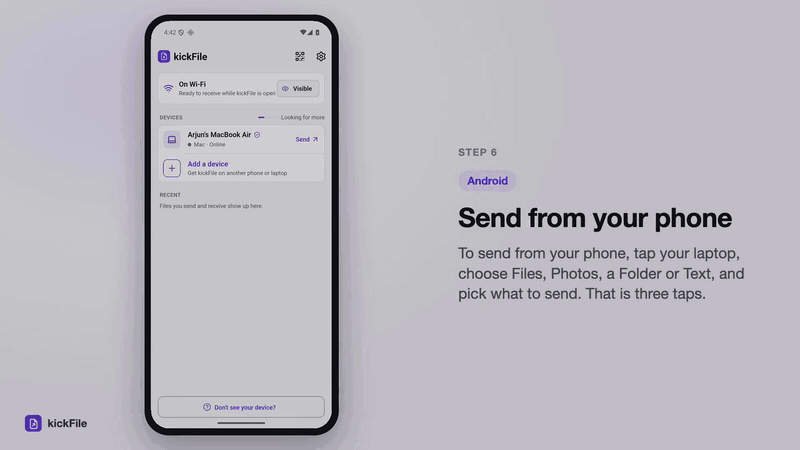
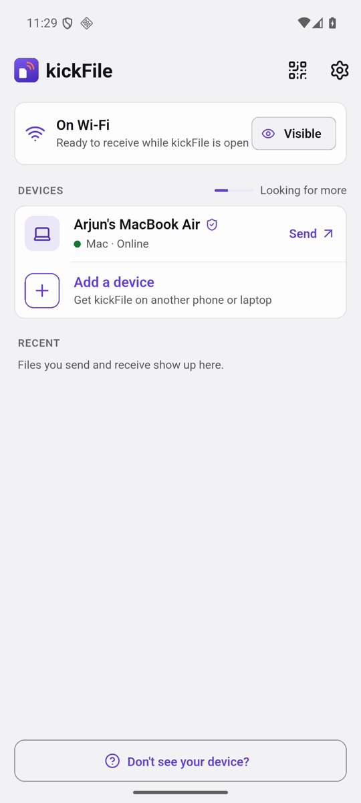
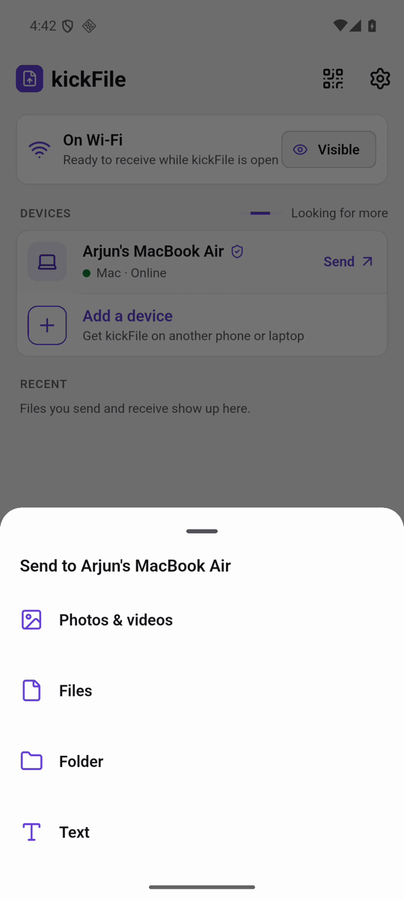
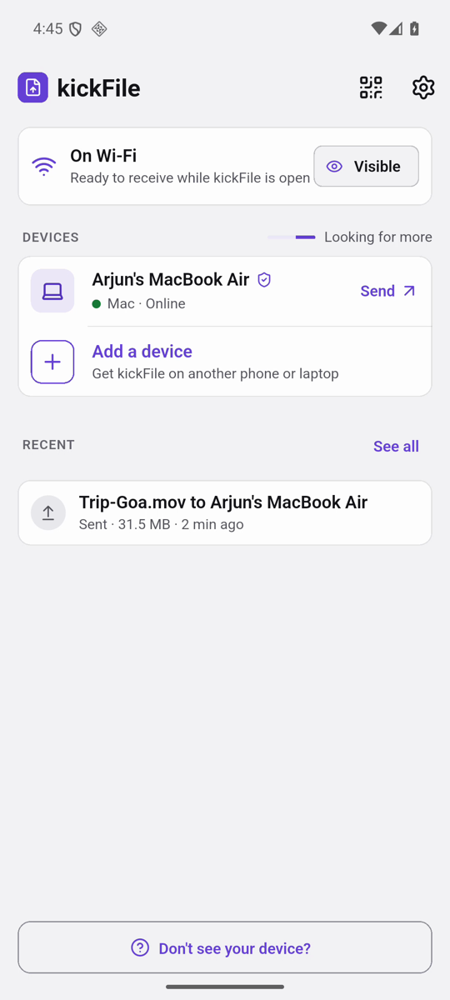
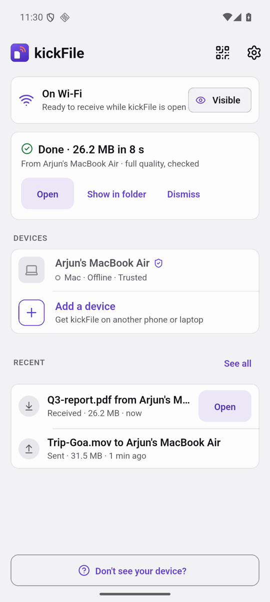
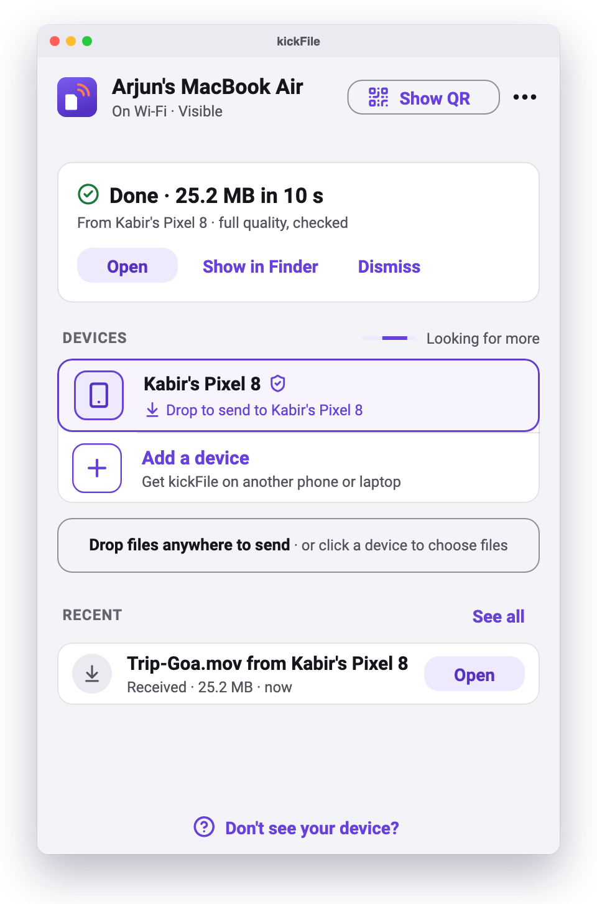
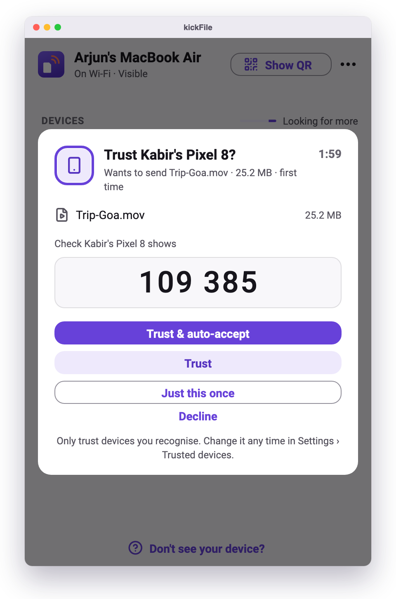
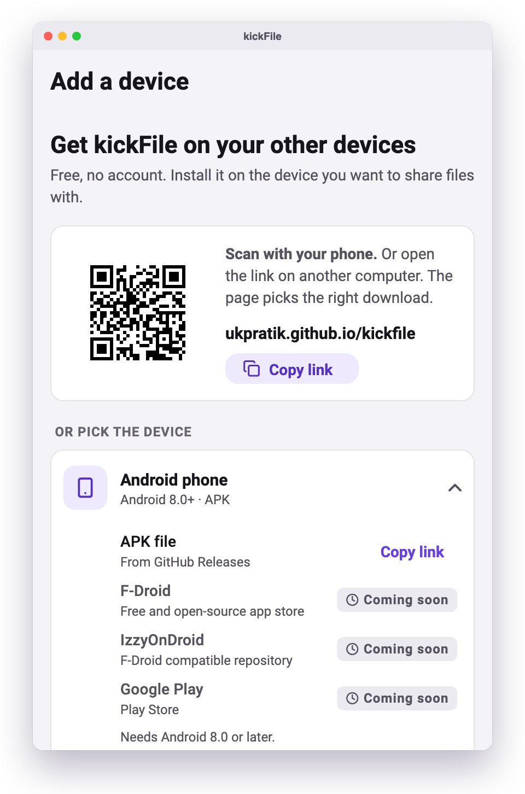

<p align="center"></p>

<h1 align="center">kickFile</h1>

<p align="center"><b>Move files between your phone and laptop over Wi-Fi or a hotspot.</b><br>
Full quality, encrypted, no cable, no account, no internet. Free and open source.</p>

<p align="center">
  <a href="https://github.com/ukpratik/kickfile/releases/latest"></a>
  <a href="https://github.com/ukpratik/kickfile/actions/workflows/ci.yml"></a>
  <a href="LICENSE"></a>
  
</p>

<p align="center"></p>

<p align="center"><a href="https://github.com/ukpratik/kickfile/releases/latest/download/kickFile-how-to.mp4">▶ Watch the 3-minute how-to video</a> (Mac, Windows and Android)</p>

## Why kickFile

Getting a video off your phone and onto your laptop shouldn't need a cable, a cloud upload or a messaging app that shrinks it. kickFile sends it straight across the Wi-Fi you're already on, at full quality, between any mix of Android, Mac, Windows and Linux.

- **Simple:** open it on both devices and they find each other. Tap a device, pick files, done. On a computer, drag files onto your phone.
- **Private:** files go directly from one device to the other, encrypted. There are no servers, no accounts and no analytics.
- **Works anywhere:** on home or office Wi-Fi, or on your phone's hotspot with no internet at all. It never uses mobile data.
- **Powerful when you need it:** whole folders, any size and type, resume after a dropped connection, trusted devices that send without asking, QR codes when the network blocks discovery.

## Download

| Platform | Get it | Needs |
|---|---|---|
| **Android** | [APK](https://github.com/ukpratik/kickfile/releases/latest/download/kickFile-android.apk) · F-Droid *(in review)* · IzzyOnDroid, Google Play *(coming soon)* | Android 8.0+ |
| **macOS** | [DMG](https://github.com/ukpratik/kickfile/releases/latest/download/kickFile-macos.dmg) · Homebrew: `brew install --cask ukpratik/tap/kickfile` | macOS 12+, Apple silicon or Intel |
| **Windows** | [Installer](https://github.com/ukpratik/kickfile/releases/latest/download/kickFile-windows-x64-setup.exe) · [Zip](https://github.com/ukpratik/kickfile/releases/latest/download/kickFile-windows-x64.zip) · Scoop: `scoop bucket add ukpratik https://github.com/ukpratik/scoop-bucket` then `scoop install ukpratik/kickfile` · winget, Microsoft Store *(coming soon)* | Windows 10/11, 64-bit |
| **Linux** | [tar.gz](https://github.com/ukpratik/kickfile/releases/latest/download/kickFile-linux-x64.tar.gz) · Flathub *(coming soon)* | x64, GTK 3 |
| **iPhone & iPad** | *Coming later* | |

Or open **[ukpratik.github.io/kickfile](https://ukpratik.github.io/kickfile)** on the device: it picks the right download. Inside the app, **Add a device** shows the same list and a QR code, so you can set up the other device from the one you already have.

<details>
<summary><b>First launch on macOS and Windows</b></summary>

- **macOS:** kickFile isn't notarised by Apple yet. Open it once, then go to **System Settings › Privacy & Security** and click **Open Anyway**. When asked, allow it to find devices on your local network.
- **Windows:** run the installer (or unzip anywhere and run `kickfile.exe`). If SmartScreen warns about an unknown app, choose **More info › Run anyway**. Allow it through the firewall on **private** networks.
- **Linux:** extract and run `kickFile/kickfile`. A system tray needs an AppIndicator extension on GNOME.
- **Android APK:** allow your browser or file manager to install unknown apps when asked. Check the APK's signing certificate against [docs/RELEASING.md](docs/RELEASING.md#certificate-fingerprints) if you like.
</details>

## How to use

kickFile works between **any two devices** that have it: phone ⇄ laptop, phone ⇄ phone or laptop ⇄ laptop, in any mix of Android, macOS, Windows and Linux. Both devices need to be on the **same network**. That can be home or office Wi-Fi, or one device's **hotspot**. kickFile doesn't need the internet and never uses mobile data.

### 1. Set up (once per device)

1. Install kickFile (see [Download](#download)) and open it.
2. Give the device a name you'll recognise, such as "Pratik's Pixel" or "Work laptop", then tap **Get started**.
3. Allow what it asks for:
   - **Android:** notifications (for incoming transfers and progress). The camera is asked for only when you scan a QR code.
   - **macOS:** **Allow** when asked to find devices on your local network.
   - **Windows:** allow kickFile through the firewall on **private** networks.
4. Open kickFile on the other device. Within a few seconds each shows the other under nearby devices.

No other device yet? Tap **Add a device**: it shows a QR code and link for the download page, so you can install kickFile on the other device straight from this one.

### 2. Send from an Android phone

- **From kickFile:** tap a device, then choose **Photos & videos**, **Files**, **Folder** or **Text**. Pick what to send and it goes straight away.
- **From any other app:** use the system **Share** button in your Gallery, Files, Chrome or another app, choose **kickFile**, then tap the device.
- **To another phone:** the same steps work phone ⇄ phone. Both phones must be on the same Wi-Fi, or one must be on the other's hotspot.

### 3. Send from a computer (Mac, Windows, Linux)

- **Drag and drop** files or folders from Finder or Explorer onto a device in the kickFile window.
- Or click a device and choose **Send files…**, **Send folder…** or **Send text…**.
- Laptop ⇄ laptop works the same way.

### 4. Receive

- The first time a device sends to you, you're asked to **Accept** or **Decline**, with the file names and sizes shown.
- **The 6-digit code:** when two devices meet for the first time, both screens show a code. If the codes match, the connection is really to that device and nobody is in between. You only check this once per device.
- When you accept, you can choose **Just this once** or **Trust & auto-accept**. A trusted device sends without asking from then on. To change this, open the device's menu (long-press on a phone, right-click on a computer). There you can **Rename**, **Trust**, turn **Auto-accept** on or off, **Forget** or **Block** the device.
- Transfers that drop because of a Wi-Fi blip or a locked screen **resume where they stopped**. Each file is checked with SHA-256 when it arrives.

**Where received files go**

| Device | Photos and videos | Other files | Text and links |
|---|---|---|---|
| Android | Gallery (`Pictures/kickFile`, `Movies/kickFile`) | `Download/kickFile` | Shown in the app with a Copy button |
| Mac, Windows, Linux | `Downloads/kickFile` | `Downloads/kickFile` | Shown in the app with a Copy button |

You can choose a different folder in **Settings › Save files to**. **History** lists everything you've sent and received. From there you can show a received file in its folder. Clearing History doesn't delete the files.

### 5. Staying ready to receive

- **Android:** receives while kickFile is open, or while a transfer is running. This saves battery. Open the app when you want to receive.
- **macOS:** closing the window keeps kickFile running in the **menu bar**, so your phone can still send to it. Quit from the menu-bar icon or with ⌘Q.
- **Windows and Linux:** closing the window keeps kickFile in the **system tray**. Right-click the tray icon to quit. On GNOME, a tray needs an AppIndicator extension. Without one, kickFile asks whether to keep receiving in the background.
- On computers, **Settings** also has **Start kickFile when you sign in** and **Keep receiving when the window is closed**.

### 6. No Wi-Fi? Use a hotspot

Turn on your phone's **hotspot** and connect the laptop (or another phone) to it. kickFile works over the hotspot. No mobile data is used for the transfer itself.

### 7. Devices can't see each other?

Open **Connection help** on the home screen or in Settings. It checks the usual causes one by one:

- **Is kickFile open on both devices?** On Android it must be on screen.
- **Same network?** Guest Wi-Fi and some office or hotel networks keep devices apart ("client isolation"). Use a hotspot instead.
- **VPN?** Turn it off, or let it allow local network traffic.
- **Firewall:** on Windows, allow kickFile on private networks and set the Wi-Fi as *Private*. On macOS, check **System Settings › Privacy & Security › Local Network**.
- **Fallback that always works on a shared network:** tap **Connect with a QR code** on one device and scan it with the other. If a device has no camera, type the short code shown under the QR instead.

### Settings at a glance

| Setting | What it does |
|---|---|
| Device name | How this device appears to others |
| Visible to nearby devices | Turn off to hide this device. You can still send from it |
| Auto-accept | Which trusted devices can send to you without a prompt |
| Save files to | Where received files are saved |
| Blocked devices | Unblock devices you blocked |
| Start when you sign in / Keep receiving when closed | Computers only |
| Export logs | Saves a diagnostic file without file names, which you can attach to a bug report |

## Screenshots

<table>
  <tr>
    <td></td>
    <td></td>
    <td></td>
    <td></td>
  </tr>
  <tr>
    <td align="center">Nearby devices</td><td align="center">Files, photos, folders or text</td><td align="center">You approve what arrives</td><td align="center">Checked and saved</td>
  </tr>
</table>

<table>
  <tr>
    <td></td>
    <td></td>
    <td></td>
  </tr>
  <tr>
    <td align="center">Drag files onto your phone</td><td align="center">Check the 6-digit code once</td><td align="center">Set up your other devices</td>
  </tr>
</table>

More in [docs/media](docs/media).

## How it works

1. Each device runs a small HTTPS server on your local network and announces itself with DNS-SD (Bonjour). If the network blocks that, kickFile probes your subnet, or you scan a QR code.
2. Every device has its own self-signed certificate. The first time two devices meet, both show a **6-digit code** derived from both certificates: if they match, nobody is in the middle. After that the certificate is pinned.
3. Files stream straight to the receiver in chunks, with a SHA-256 check at the end. A dropped connection resumes from where it stopped.

Details: [docs/ARCHITECTURE.md](docs/ARCHITECTURE.md) and the wire protocol in [docs/PROTOCOL.md](docs/PROTOCOL.md).

## Privacy

kickFile collects nothing. No servers, no account, no analytics, no crash reporting, no ads. Received files stay where they're saved; settings, trusted devices and recent transfers stay on the device. The camera is used only to scan kickFile QR codes. Full policy: [ukpratik.github.io/kickfile/privacy](https://ukpratik.github.io/kickfile/privacy/).

## Build from source

You need [Flutter](https://docs.flutter.dev/get-started/install) **3.47.5** (stable) and, per platform, the usual Flutter toolchain (Android SDK + JDK 17, Xcode, Visual Studio with C++ workload, or `clang cmake ninja-build pkg-config libgtk-3-dev libayatana-appindicator3-dev` on Linux).

```bash
git clone https://github.com/ukpratik/kickfile.git
cd kickfile/app
flutter pub get
flutter run                        # on a connected device or this desktop
flutter build apk --release        # or: macos | windows | linux
```

Without a signing key, `flutter build apk --release` produces an unsigned APK; see [docs/RELEASING.md](docs/RELEASING.md) for signing.

### Tests

```bash
cd app
flutter analyze
flutter test                       # unit, widget and two-device transfer tests on loopback
```

The `video` tag renders the screens used in the docs and is skipped unless `KF_VIDEO=<dir>` is set.

## Project layout

```
app/                Flutter app (Android, macOS, Windows, Linux)
  lib/core/         protocol, identity and certificates, verification code
  lib/net/          HTTPS server and client, discovery, subnet probe
  lib/transfer/     sender, receiver, resume, history
  lib/ui/           screens, widgets, theme
docs/               architecture, protocol, releasing, screenshots
fastlane/           F-Droid / store listing (text and images)
fdroid/             F-Droid build recipe (metadata submitted to fdroiddata)
site/               download page and privacy policy (GitHub Pages)
tool/video/         how the how-to video is made
```

## Contributing

Bug reports, translations and pull requests are welcome. Please read [CONTRIBUTING.md](CONTRIBUTING.md) first; for security issues see [SECURITY.md](SECURITY.md).

## Licence

kickFile is free software: you can redistribute it and/or modify it under the terms of the **GNU General Public License, version 3 or later**. See [LICENSE](LICENSE).

Copyright © 2026 Pratik Ukey.
