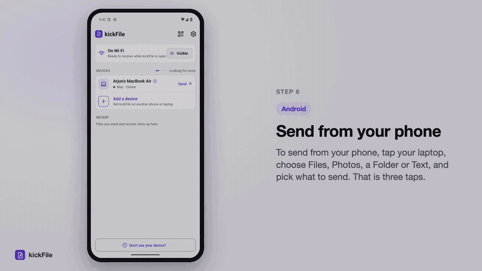
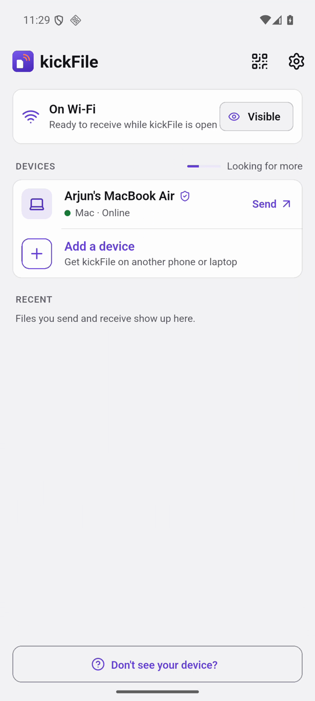
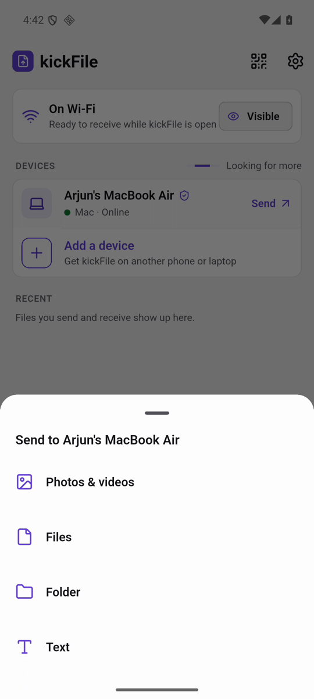
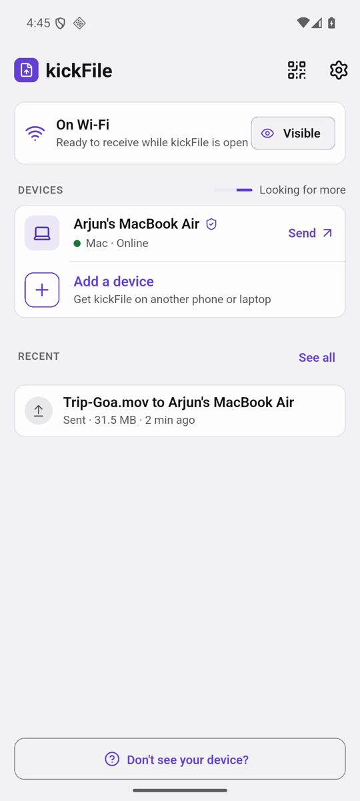
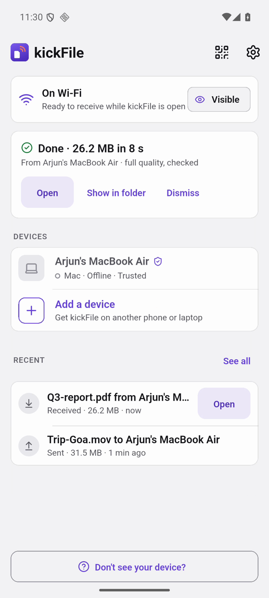
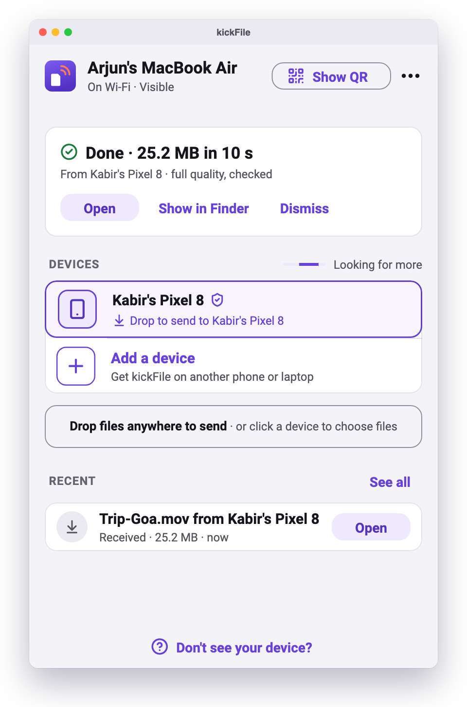
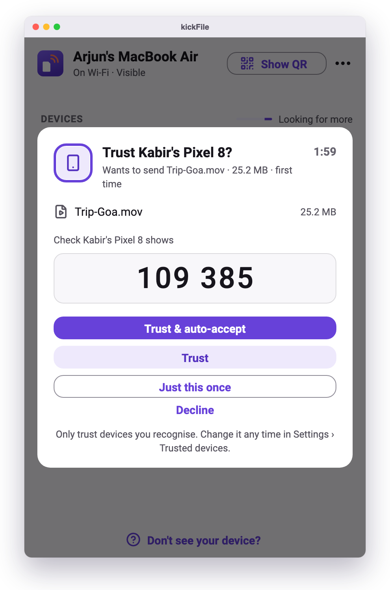
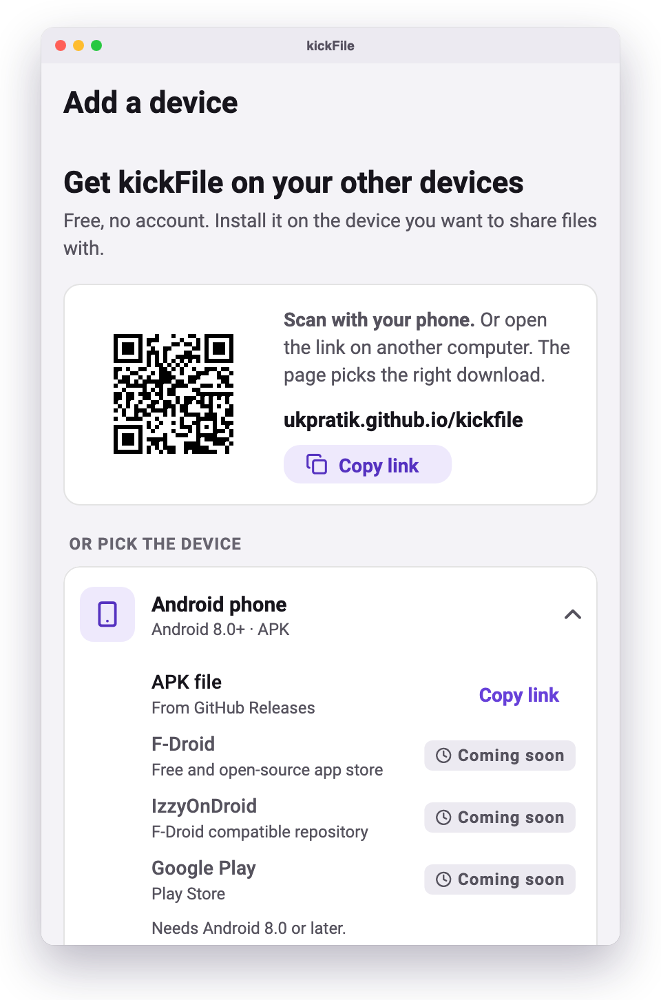

<p align="center"></p>

<h1 align="center">kickFile</h1>

<p align="center"><b>Move files between your phone and laptop over Wi-Fi or a hotspot.</b><br>
Full quality, encrypted, no cable, no account, no internet. Free and open source.</p>

<p align="center">
  <a href="https://github.com/ukpratik/kickfile/releases/latest"></a>
  <a href="https://github.com/ukpratik/kickfile/actions/workflows/ci.yml"></a>
  <a href="LICENSE"></a>
  
</p>

<p align="center"></p>

<p align="center"><a href="https://github.com/ukpratik/kickfile/releases/latest/download/kickFile-how-to.mp4">▶ Watch the 3-minute how-to video</a> (Mac, Windows and Android)</p>

## Why kickFile

Getting a video off your phone and onto your laptop shouldn't need a cable, a cloud upload or a messaging app that shrinks it. kickFile sends it straight across the Wi-Fi you're already on, at full quality, between any mix of Android, Mac, Windows and Linux.

- **Simple:** open it on both devices and they find each other. Tap a device, pick files, done. On a computer, drag files onto your phone.
- **Private:** files go directly from one device to the other, encrypted. There are no servers, no accounts and no analytics.
- **Works anywhere:** on home or office Wi-Fi, or on your phone's hotspot with no internet at all. It never uses mobile data.
- **Powerful when you need it:** whole folders, any size and type, resume after a dropped connection, trusted devices that send without asking, QR codes when the network blocks discovery.

## Download

| Platform | Get it | Needs |
|---|---|---|
| **Android** | [APK](https://github.com/ukpratik/kickfile/releases/latest/download/kickFile-android.apk) · F-Droid, IzzyOnDroid, Google Play *(coming soon)* | Android 8.0+ |
| **macOS** | [DMG](https://github.com/ukpratik/kickfile/releases/latest/download/kickFile-macos.dmg) · Homebrew *(coming soon)* | macOS 12+, Apple silicon or Intel |
| **Windows** | [Zip](https://github.com/ukpratik/kickfile/releases/latest/download/kickFile-windows-x64.zip) · winget, Microsoft Store *(coming soon)* | Windows 10/11, 64-bit |
| **Linux** | [tar.gz](https://github.com/ukpratik/kickfile/releases/latest/download/kickFile-linux-x64.tar.gz) · Flathub *(coming soon)* | x64, GTK 3 |
| **iPhone & iPad** | *Coming later* | |

Or open **[ukpratik.github.io/kickfile](https://ukpratik.github.io/kickfile)** on the device: it picks the right download. Inside the app, **Add a device** shows the same list and a QR code, so you can set up the other device from the one you already have.

<details>
<summary><b>First launch on macOS and Windows</b></summary>

- **macOS:** kickFile isn't notarised by Apple yet. Open it once, then go to **System Settings › Privacy & Security** and click **Open Anyway**. When asked, allow it to find devices on your local network.
- **Windows:** unzip anywhere and run `kickfile.exe`. If SmartScreen warns about an unknown app, choose **More info › Run anyway**. Allow it through the firewall on **private** networks.
- **Linux:** extract and run `kickFile/kickfile`. A system tray needs an AppIndicator extension on GNOME.
- **Android APK:** allow your browser or file manager to install unknown apps when asked. Check the APK's signing certificate against [docs/RELEASING.md](docs/RELEASING.md#certificate-fingerprints) if you like.
</details>

## Screenshots

<table>
  <tr>
    <td></td>
    <td></td>
    <td></td>
    <td></td>
  </tr>
  <tr>
    <td align="center">Nearby devices</td><td align="center">Files, photos, folders or text</td><td align="center">You approve what arrives</td><td align="center">Checked and saved</td>
  </tr>
</table>

<table>
  <tr>
    <td></td>
    <td></td>
    <td></td>
  </tr>
  <tr>
    <td align="center">Drag files onto your phone</td><td align="center">Check the 6-digit code once</td><td align="center">Set up your other devices</td>
  </tr>
</table>

More in [docs/media](docs/media).

## How it works

1. Each device runs a small HTTPS server on your local network and announces itself with DNS-SD (Bonjour). If the network blocks that, kickFile probes your subnet, or you scan a QR code.
2. Every device has its own self-signed certificate. The first time two devices meet, both show a **6-digit code** derived from both certificates: if they match, nobody is in the middle. After that the certificate is pinned.
3. Files stream straight to the receiver in chunks, with a SHA-256 check at the end. A dropped connection resumes from where it stopped.

Details: [docs/ARCHITECTURE.md](docs/ARCHITECTURE.md) and the wire protocol in [docs/PROTOCOL.md](docs/PROTOCOL.md).

## Privacy

kickFile collects nothing. No servers, no account, no analytics, no crash reporting, no ads. Received files stay where they're saved; settings, trusted devices and recent transfers stay on the device. The camera is used only to scan kickFile QR codes. Full policy: [ukpratik.github.io/kickfile/privacy](https://ukpratik.github.io/kickfile/privacy/).

## Build from source

You need [Flutter](https://docs.flutter.dev/get-started/install) **3.47.5** (stable) and, per platform, the usual Flutter toolchain (Android SDK + JDK 17, Xcode, Visual Studio with C++ workload, or `clang cmake ninja-build pkg-config libgtk-3-dev libayatana-appindicator3-dev` on Linux).

```bash
git clone https://github.com/ukpratik/kickfile.git
cd kickfile/app
flutter pub get
flutter run                        # on a connected device or this desktop
flutter build apk --release        # or: macos | windows | linux
```

Without a signing key, `flutter build apk --release` produces an unsigned APK; see [docs/RELEASING.md](docs/RELEASING.md) for signing.

### Tests

```bash
cd app
flutter analyze
flutter test                       # unit, widget and two-device transfer tests on loopback
```

The `video` tag renders the screens used in the docs and is skipped unless `KF_VIDEO=<dir>` is set.

## Project layout

```
app/                Flutter app (Android, macOS, Windows, Linux)
  lib/core/         protocol, identity and certificates, verification code
  lib/net/          HTTPS server and client, discovery, subnet probe
  lib/transfer/     sender, receiver, resume, history
  lib/ui/           screens, widgets, theme
docs/               architecture, protocol, releasing, screenshots
fastlane/           F-Droid / store listing (text and images)
fdroid/             draft F-Droid build recipe
site/               download page and privacy policy (GitHub Pages)
tool/video/         how the how-to video is made
```

## Contributing

Bug reports, translations and pull requests are welcome. Please read [CONTRIBUTING.md](CONTRIBUTING.md) first; for security issues see [SECURITY.md](SECURITY.md).

## Licence

kickFile is free software: you can redistribute it and/or modify it under the terms of the **GNU General Public License, version 3 or later**. See [LICENSE](LICENSE).

Copyright © 2026 Pratik Ukey.
