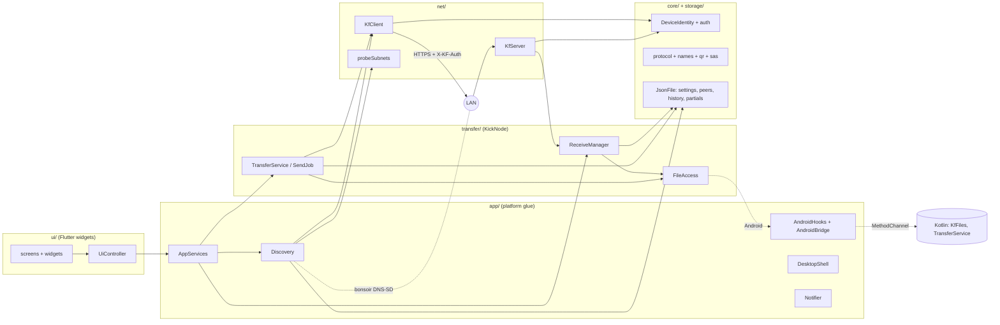

# kickFile architecture

kickFile is a single Flutter app (in `app/`) that runs the same transfer engine on Android, macOS, Windows and Linux. Every device runs an HTTPS server and an HTTPS client. A device finds others on the local network with DNS-SD (falling back to probing its own /24 subnet), and sends files by making signed requests to the receiver's server. Each device's identity is a self-signed EC P-256 certificate, pinned by its SHA-256 fingerprint. All state is local JSON files; there is no cloud service, account or relay. The wire protocol is described in [PROTOCOL.md](PROTOCOL.md).

## Components



`KickNode` (`transfer/node.dart`) is the whole engine for one device: identity, stores, server, client, sender and receiver. It has no Flutter plugin dependencies, so tests run two nodes on loopback. `AppServices` (`app/services.dart`) wraps a node with discovery, notifications, wake lock and per-platform file access.

## Module map (`app/lib/`)

| Path | What lives there |
|---|---|
| `main.dart` | Entry point; on desktop, `--background` starts hidden in the tray. |
| `core/protocol.dart` | Protocol constants (version, port, service type, limits, timeouts), `DeviceInfo`, `TransferOffer`/`OfferItem` and offer validation. |
| `core/identity.dart` | Key pair and self-signed certificate generation, fingerprint, ECDSA sign/verify. |
| `core/auth.dart` | Builds and verifies the `X-KF-Auth` request signature; nonce cache. |
| `core/sas.dart` | The 6-digit verification code from two fingerprints. |
| `core/qr.dart` | `kickfile://c?...` pairing links and `23-482913` short codes. |
| `core/names.dart` | Relative path validation (no traversal), per-OS file name sanitising, `name (1).ext` collisions. |
| `core/errors.dart` | `KfErrorCode`: every engine error, its HTTP status and wire name. |
| `core/log.dart` | File logger (no file names or content in logs). |
| `net/server.dart` | `KfServer`: HTTPS server, routing, JSON bodies, error mapping. Delegates decisions to a `ServerPolicy`. |
| `net/client.dart` | `KfClient`: pinned HTTPS client per peer, signed requests, upload with stall watchdog. |
| `net/probe.dart` | Subnet probe: `GET /v1/info` to every host in our /24s. |
| `net/netinfo.dart` | Usable IPv4 addresses (skips VPN and virtual adapters), link kind, VPN detection. |
| `transfer/node.dart` | `KickNode`: wiring, start/stop, QR and short-code pairing. |
| `transfer/sender.dart` | `SendJob`: one outgoing transfer, its state machine, retry and resume. |
| `transfer/transfer_service.dart` | Owns outgoing jobs, records them in history. |
| `transfer/receiver.dart` | `ReceiveManager` (the `ServerPolicy`): accept prompt, trust, busy/rate limit, writes, hashes, partial manifests. |
| `transfer/file_access.dart` | `FileAccess` interface: read sources, write partials, finalize, free space. |
| `transfer/io_file_access.dart` | `dart:io` implementation for desktop and tests. |
| `transfer/models.dart` | `Hasher` (incremental SHA-256), `SpeedMeter`, `ActiveClock`. |
| `storage/json_store.dart` | `JsonFile`: atomic, serialised JSON writes with a schema version. |
| `storage/settings.dart`, `peers.dart`, `history.dart` | Settings, known devices (trust/auto-accept/block/alias/addresses), transfer history. |
| `app/services.dart` | `AppServices`: builds the node for the current platform, keep-awake. |
| `app/discovery.dart` | DNS-SD broadcast and browse (bonsoir), probe fallback, liveness pings. |
| `app/android_bridge.dart` | Dart side of the Kotlin channels; `AndroidFileAccess`. |
| `app/android_hooks.dart` | Share intents, `kickfile://` links, foreground service updates, background behaviour. |
| `app/desktop_shell.dart` | Window, tray menu, close-to-background, launch at login. |
| `app/notifier.dart`, `app/os_actions.dart` | Local notifications; open/reveal files, desktop device name. |
| `ui/` | `app.dart` (root, routing of prompts), `controller.dart` (UI actions), `screens/`, `widgets/`, `theme/`. |

Platform channels (Android only): `MethodChannel('kickfile/files')` for pickers, file I/O, MediaStore and the foreground service; `EventChannel('kickfile/intents')` for share and link intents. Kotlin lives in `app/android/app/src/main/kotlin/io/github/ukpratik/kickfile/` (`KfFiles.kt`, `TransferService.kt`, `MainActivity.kt`).

## Key flows

### Discovery (`app/discovery.dart`)

- **Announce**: while Visible, register `_kickfile._tcp` on the server port with TXT `v`, `fp`, `p`. Hidden devices don't announce.
- **Browse**: on resolve, ignore our own `fp`, use IPv4 addresses only, then confirm with a pinned `GET /v1/info` (the TLS certificate must match the TXT `fp`). A TXT `v` other than `1` marks the device "needs update".
- **Probe fallback**: if nothing is online 3 s after start, and every 30 s while the list is empty, probe every host in our /24 subnets on port 47420 (64 in parallel, 600 ms timeout). The certificate fingerprint must equal the `fp` the device reports.
- **Known addresses**: trusted devices are also tried at their last addresses (on start and every 12 s), which covers Hidden devices and networks that block multicast.
- **Liveness**: every 4 s, ping each device with a known address (2 s timeout); two failures mark it offline. Any verified incoming request marks the sender online at its source address.
- **Pairing**: the QR screen shows a `kickfile://c?...` link with addresses, port, fingerprint and a one-time 6-digit secret (10 min). Scanning it calls `/v1/info?s=` and `/v1/pair`; both sides then trust each other. The typed short code `<last octet>-<secret>` resolves against the scanner's own /24 and learns the fingerprint from the device.

### Sending (`transfer/sender.dart`)

1. Build an offer: items `i0`, `i1`, ... (files, folders, text), paths sanitised; validate.
2. `POST /v1/transfers` and wait (up to 60 s plus margin) for the receiver's answer: per-file offsets and done items.
3. For each file: stat it (size and mtime must match the offer, else `source_changed`/`source_missing` for that item only), `PUT` the remaining bytes from the offset while hashing the whole file, then `POST .../done` with the SHA-256.
4. `POST .../finish`. The job ends `done`, or `partial` if some items failed.

Retries: `offset_mismatch` restarts once from the receiver's `received`; `hash_mismatch` resends once from 0. After acceptance, `unreachable`, `io`, `busy` or `unknown_transfer` pause the job and retry `/v1/info` every 3 s for 30 s; then it waits for the user's Resume. `no_space` waits for Resume directly.

### Receiving (`transfer/receiver.dart`)

- Blocked sender: `declined`. Same sender re-offering a known transfer id: resume (below). More than one new offer per sender per 5 s: `rate_limited`.
- Free space is checked first (total + 64 MiB): `no_space`. Then `busy` if a prompt is open or another session moved data in the last 30 s.
- **Auto-accept**: a trusted device with auto-accept on is accepted without a prompt.
- **Prompt**: otherwise the UI gets an `IncomingRequest`. First contact (not trusted) shows the verification code, and a warning if a trusted device with the same name and platform now has a different key. Answers: accept once, trust, trust and auto-accept, decline, block. No answer in 60 s: `timeout`, recorded as missed.
- Files are written to a partial (desktop: `<save dir>/.kickfile-partial/<transfer>/<item>.part`; Android: a MediaStore pending item) in 1 MiB batches, hashed as they arrive, verified on `done`, then moved to the final name with a `(n)` suffix on collisions and the sender's mtime.

### Resume

- The receiver keeps a manifest per accepted transfer in `<support>/partials/<id>.json` (offer, sender, partial refs, done flags), saved at most once a second. Manifests survive restarts and expire after 24 h with their partials.
- A session with no data for 30 s is paused. Re-sending the same offer id returns the current partial lengths; the sender continues from there, re-hashing the bytes already sent.
- Each upload bumps a per-item generation, so a stale handler from an old half-open connection can't write, hash or pause after a newer upload took over.

### Stall watchdog (`net/client.dart`)

The client owns the upload body stream. A timer checks every `stallAfter/3`; if no bytes moved for 15 s it aborts the request and fails the addStream race, so the job shows paused instead of frozen progress. Cancel uses the same path. The receiver separately pauses stale sessions after 30 s.

### Storage (`storage/`)

| File (in the app support dir) | Contents |
|---|---|
| `identity.json` | Private key and certificate (PEM), `chmod 600` on POSIX. |
| `settings.json` | Device name, visibility, save folder, theme, background and login options, shown prompts. |
| `peers.json` | Devices by fingerprint: name, alias, platform, trusted, autoAccept, blocked, lastSeen, addresses, port. |
| `history.json` | Up to 500 entries or 90 days, newest first; outgoing entries left waiting, active or paused by a quit become "interrupted" on load. |
| `partials/<id>.json` | Resume manifests (above). |
| `logs/kickfile.log` | Log file. |

`JsonFile` writes `{"schema": 1, ...}` to `<file>.tmp` with flush, then renames over the target, with writes queued per file. A file with a newer `schema` is copied to `<file>.v<n>.bak` and treated as empty. `KF_PROFILE=<name>` gives a separate data dir and save folder, so two copies run on one computer.

## Android specifics

- **Pickers** (`KfFiles.kt`): photo picker (`PickMultipleVisualMedia`), document picker, and `ACTION_OPEN_DOCUMENT_TREE` for folders (walked into files and empty dirs). Sources are content URIs, read in 1 MiB chunks over the channel.
- **MediaStore** (API 29+): images go to `Pictures/kickFile/...`, videos to `Movies/kickFile/...`, everything else to `Download/kickFile/...`, as `IS_PENDING` items finalised on `done`. API 26–28 write `.kfpart` files in `Download/kickFile` and need the storage permission.
- **Share intents**: `SEND` / `SEND_MULTIPLE` (any MIME type; `EXTRA_TEXT` without a stream becomes a text item) and `VIEW` with the `kickfile` scheme (QR links opened by the camera app) arrive on `kickfile/intents`.
- **Foreground service**: `TransferService.kt`, type `dataSync`, runs only while a transfer is active and shows progress (updated every second). On Android 15's dataSync time limit it stops; the sender can resume later.
- In the background the app stops announcing on DNS-SD and stops liveness pings; it resumes on return.

## Desktop specifics

- **Window**: 420×640 (min 360×520) via `window_manager`; close hides to the tray (Linux asks once whether to keep receiving in the background).
- **Tray**: open, current status, send files, show QR code, Visible toggle, quit (`tray_manager`).
- **Drag and drop**: `desktop_drop` on the home screen; dropping onto a device row sends to it.
- **Launch at login**: `launch_at_startup` with `--background` on Windows and Linux; skipped on macOS.
- Received files go to `~/Downloads/kickFile` by default (changeable in Settings).

## Testing

Tests live in `app/test/`:

| Folder | What |
|---|---|
| `core/` | Path validation, sanitising, offer validation, identity and auth header. |
| `transfer/` | End-to-end on loopback with two real nodes (`support/nodes.dart`): trust prompt, decline/block, timeout, busy and rate limit, cancel from either side, drop and resume, hash mismatch, path traversal, unsigned requests, certificate pin, QR/short-code pairing, Hidden mode. |
| `ui/` | Widget tests for screens. |
| `bench/` (`bench` tag) | Throughput benchmarks; run with `KF_BENCH=1`. |
| `shots/` (`shots` tag) | Renders screens to PNG; `KF_SHOTS=<dir>`. |
| `video/` (`video` tag) | Renders the desktop scenes of the how-to video; `KF_VIDEO=<dir>`. |
| `tools/` (`tool` tag) | A long-running test peer for manual testing on real devices; `KF_PEER_DIR=<dir>`. |

```sh
cd app
flutter analyze
flutter test                      # everything; tagged suites skip themselves
KF_VIDEO=/tmp/kf-video flutter test test/video
KF_BENCH=1 flutter test test/bench
```

The tagged suites are skipped by default because each test is marked `skip:` unless its environment variable is set; there is no `dart_test.yaml`, so `--exclude-tags video` also works but isn't required. CI (`.github/workflows/ci.yml`) runs `flutter analyze` and `flutter test`, then builds.
